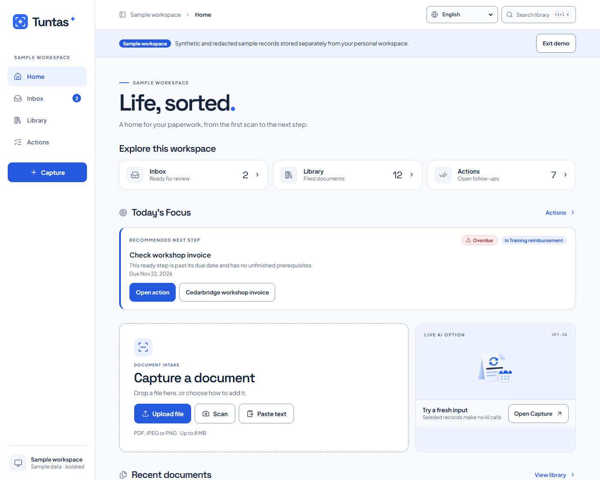
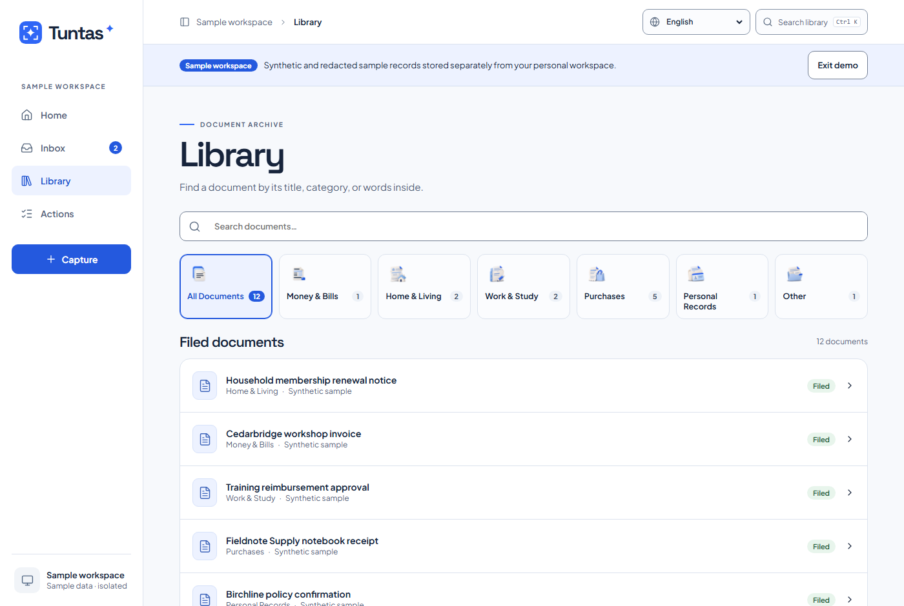
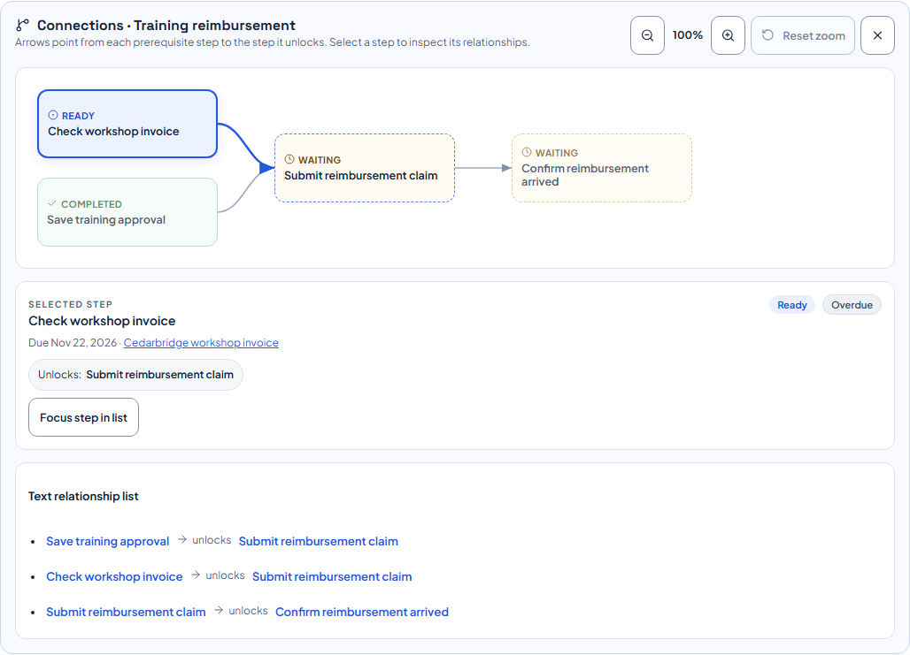

# Tuntas ✦
Capture a document once. Find it later by what it contains, correct uncertain filing, or attach a follow-up. This is a local-first web MVP based on the actual Tuntas Stitch exports. No Firebase account is required for the browser-only workflow.

[Open the live demo](https://tuntas-dev.web.app/?demo=1#/home) · [Judging walkthrough](docs/submission/JUDGING.md)

## Screenshots

**Home** shows Today’s Focus and document capture.



**Library** combines illustrated category filters with document search.



**Actions** shows how prerequisites connect in the training reimbursement workflow.



## Run locally
Use Node 22.13+ and npm. From this folder:
```sh
npm ci
npm run dev
```
Open the loopback URL printed by Vite. Use the **same hostname, port and browser profile** on later visits. A separate profile starts empty. For the production bundle use `npm run build`, then `npm run preview`. Public deployment is not part of this setup.

## Try it

The live demo opens a populated sample workspace with Inbox reviews, searchable receipts, and linked Actions. Four redacted receipt photographs are available under **Original document** in Library. Switch between **English** and **Bahasa Indonesia** in the header. Use **Exit demo** to return to the entry page.

For a quick tour from the personal workspace:

1. On Home choose **Try sample** on the synthetic Household renewal card. It uses Local rules and shows a source-linked follow-up.
2. Choose **Add follow-up**, check the excerpt and due date, then choose **Create action**. Reload Actions and follow the document link to open the original.
3. In Library, search for `household renewal` to find the document again. Use **Undo filing** to move it to Inbox. Trying the same sample again opens the existing document.
4. Paste `Sample lease and invoice`: conflicting matches need review. Submit a PDF without a text layer: the original remains available for retry, download or manual filing.

## Storage, formats and boundaries
IndexedDB stores originals, document records, and actions in the browser. The demo, the signed-out workspace, and each signed-in account have separate local stores. File staging uses unique SHA-256 fingerprints, and clearing site data removes local copies.

Use **Account** to sign in with Google or email and password. Cross-device sync is optional. When enabled, Firestore stores filing metadata and action progress under the account's Firebase UID. Original files, extracted text, saved facts, and evidence excerpts stay on the device. The [Firestore rules](firestore.rules) enforce account ownership and validate which fields can sync.

Accepts one PDF, JPEG or PNG up to 8 MiB; 24-megapixel image cap; 16,000 characters of pasted text; 300 documents per workspace. PDF.js reads up to 8 pages / 16,000 characters of embedded text in a worker. Partial reads require review. A scanned PDF is never described as an on-device PDF inference: manually file, or supply a photograph. Native camera availability depends on browser and device; no deskew or multipage OCR. Local rules recognize a few literal document types and labeled totals, not arbitrary natural language. An open tab supports offline local filing; cold offline app launch and background sync are not implemented.

## Firebase integration
The hosted demo passed production App Check and consented cloud inference in a signed-out Chrome profile. The renewal excerpt and due date matched the original, and the confirmed action survived reload. Desktop CPU inference also returned **Firebase · on device** for a synthetic renewal with zero cloud generation requests. The installed local manifest identified **v3Nano**. See [model provenance](docs/PROVENANCE.md) and the [judging walkthrough](docs/submission/JUDGING.md).

The Firebase classifier is invoked from the configured Capture and Retry controls. The Home sample uses local rules. `src/firebase-ai.js` uses the modular SDK and App Check, initializes the model from the button gesture and calls `generateContent`. `src/engine.js` selects a swappable classifier.

For a future authorized test:
1. Register a development web app with Firebase AI Logic (Gemini Developer API). Use [Firebase's current hybrid web setup](https://firebase.google.com/docs/ai-logic/hybrid/web/get-started), including a supported Chrome desktop, Prompt API setup and device model availability. A browser with ordinary JavaScript support alone is insufficient.
2. Register **reCAPTCHA Enterprise** for the web app; enable AI Logic App Check enforcement. Follow Firebase’s local debug-provider instructions for a private development token if needed. Never commit a token, use a service account in the frontend, or whitelist localhost as a production attestation domain. Set AI quotas in the Firebase project before testing; the local input cap is not a server-side spending limit.
3. Copy `.env.example` to `.env.local`, fill the public web app settings and site key, then restart Vite. The app can run in local mode without Firebase configuration.
4. Paste a **new synthetic** receipt via Capture. Select **device only** to prohibit cloud fallback. A first model download can take time. For a separate consented test select hybrid and tick its per-document disclosure. In hybrid mode PDF text, pasted text or JPEG/PNG bytes may be sent to Google's model; raw PDF files are never sent. Cloud mode does not store a copy in Firestore or Storage.
5. On success inspect the returned processing source; unreported source stays unreported. On failure the app keeps the original. Verify device and cloud outcomes separately before recording competition footage. Download/setup delays can require a retry; UI timeout does not cancel a request already sent to the SDK.

## Verification
```sh
npm test
npx playwright install chromium webkit
npm run test:e2e
npm run test:e2e:webkit
npm run test:rules
npm run test:e2e:sync
npm run test:e2e:sync:webkit
npm run build
```
Playwright uses an isolated profile and a separate loopback server on port 5174. Fixtures are generated synthetic bytes. To regenerate demo screenshots with the normal dev server running at 5173, use `node scripts/demo-screens.mjs`. See [test observations](docs/VERIFICATION.md).

[Stitch audit and priorities](docs/STITCH-AUDIT.md) · [routes and processing states](docs/FLOW.md) · [competition and provenance](docs/PROVENANCE.md).


[Judging instructions](docs/submission/JUDGING.md) · [Release validation](docs/submission/VALIDATION.md)

Raw Google Stitch exports, AI prompts/handovers and submission drafts remain local and are excluded by `.gitignore`. They are not application runtime dependencies. The source, license, third-party notices and app documentation are versioned; `npm ci` and `npm run build` do not require those design exports.
