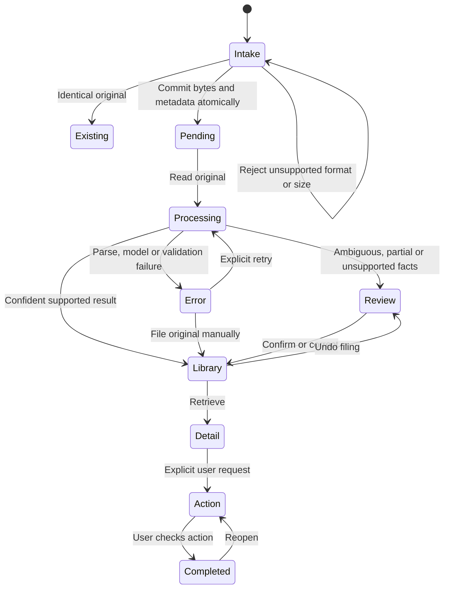

# Tuntas V1 · routes and states

| URL after # | Goal | Primary interaction |
|---|---|---|
| /home | Focus & capture | See Today’s Focus (when populated), capture a file/scan/text or try the sample notice above Recent documents, or switch to the isolated sample workspace via Explore demo |
| /capture | Supply an original | Drop/select one file or paste text, choose processing, Save & organize |
| /inbox | Resolve exceptions | Open uncertain, interrupted or failed record; fix or retry |
| /library | Retrieve filed records | Search all query words across title, name, category, text, facts and tags; combine with illustrated category tiles |
| /document/:id | Inspect, correct, or delete | Original download, evidence, editable facts, filing undo, add an optional action, or permanently delete a filed document and its linked follow-ups |
| /actions | Finish connected follow-ups | Filter by Open / No Due Date / Completed, edit due dates, inspect Evidence at a glance, group steps, link prerequisites, view interactive connection graph, complete or reopen |

There is no cloud-storage upload phase in the browser workspace. The displayed saving/reading/processing stages correspond to operations, not a timer. Opening a pending/processing record after interruption offers retry/manual recovery. Search is literal word matching combined with the seven illustrated category tiles (`All Documents` resets only the category filter). Actions support local-calendar urgency badges, due-date editing and missing-date review, optional non-nested groups with progress counts, manual prerequisite links (with deterministic cycle prevention and advisory override), an optional interactive SVG + text connection graph, and deterministic Today’s Focus recommendations. Text is rendered as text. The immutable source and original filing proposal are separate from edits.

Desktop: persistent left rail and top search; tablet switches by available width. Mobile: Home / Inbox / Capture / Library / Actions dock; document forms flow in one column. Keyboard: native controls, skip link, visible focus, Ctrl/Cmd-K to Library search, focus moves to the destination heading. Compare the [design inventory](STITCH-AUDIT.md) and the generated [desktop](demo/desktop.png) / [mobile](demo/mobile.png) images.

